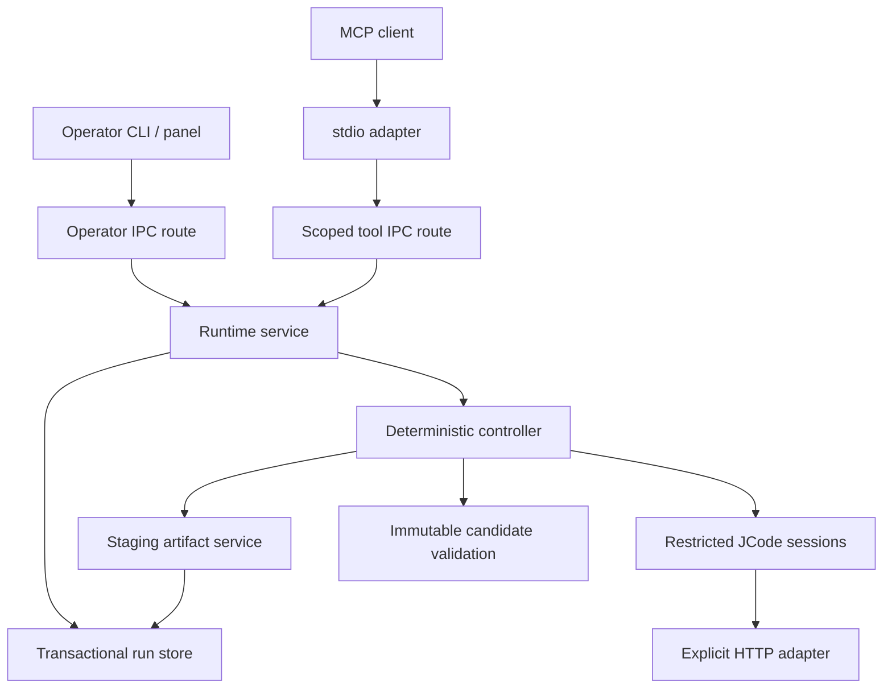

# Architecture and invariants

The runtime separates model decisions, authority, durable state and effects.
The public adapter never owns a paid run; a native session never owns global
orchestration; a diagnostic model never owns the validation verdict.

The arrows describe ownership. Native sessions cannot open arbitrary network or
filesystem handles: HTTP and artifact effects cross explicit host adapters.

## Module boundaries

| Subsystem                | Responsibility                                                          | Authority it does not receive               |
| ------------------------ | ----------------------------------------------------------------------- | ------------------------------------------- |
| `mcp/`                   | Official SDK framing, one action-discriminated tool, envelopes          | Operator settings or worker lifetime        |
| `control/`               | Authentication, scoped identity, revision-checked settings, local IPC   | Model-selected permissions                  |
| `service.ts`             | Admission, idempotency, visibility, startup recovery                    | Model reasoning or file edits               |
| `storage/`               | SQLite transactions, generations, registry, inbox watermarks, artifacts | Network/model decisions                     |
| `controller/`            | Phase transitions, Activator/Diagnosis, candidates, repairs             | Override of failed checks                   |
| `primitives/`            | File-owner scheduling, literal messages, activation queue, barrier      | Recursive public MCP calls                  |
| `engine/`                | Pinned native process, bounded wire protocol and role acknowledgement   | Ambient JCode daemon or credentials         |
| `models/`                | Explicit endpoint HTTP, probes, budget reservations                     | Tool execution or session history ownership |
| `workspace/`             | Path identities, baselines, compare-and-swap writes, candidates/diffs   | Primary workspace mutation                  |
| `validation/`            | OS/container restrictions, bounded processes, cleanup receipts          | Model changes to checks or isolation        |
| `packages/operator-tui/` | Terminal rendering, forms and operator requests                         | Provider access or task execution           |

The native catalog supplies model-facing tool descriptions and schemas after a
restricted policy acknowledgement. The host does not keep a second handwritten
catalog. The shared JCode turn core owns conversation history and correlation of
model requests, assistant tool calls and tool results. TypeScript supplies HTTP
and controlled effects, then persists opaque native conversation checkpoints.
The ordinary nonstreaming `Agent::run_turn` path and restricted headless sessions
both use this core. Upstream's separate streaming loop is not migrated by this
change, and the restricted executable does not load the interactive daemon's
tools, providers or credentials.

## Lifetimes and identity

`serve` takes an OS-backed exclusive SQLite ownership lock, separate from the run
database. The PID file is diagnostic, not the locking authority. The OS releases
the lock on crash; there is no race-prone stale-PID unlink protocol. Offline
`doctor` and uninstall take the same fence. An uninstall marks the state directory
as deleting before releasing its lock, so a concurrent service cannot reopen it.

The service recovers validation leases and completes initial retention before
opening its IPC listener. Abandoned nonterminal
runs receive a new execution generation and become `interrupted`. Terminal
records remain readable; arbitrary side effects are not replayed. The run store
uses WAL mode and full synchronization. Transactions never cross an `await`.

An MCP pipe closing ends its adapter, not the accepted run. Client credentials
bind principal, tool binding, workspace/profile allowlists and actions. Every
lookup checks those bindings. Operator credentials work only on management IPC.

A run snapshots configuration at admission. Profile edits affect subsequent
runs. The `(principal, tool_binding, client_request_id)` key is checked before
mutable defaults are resolved. Repeating exact explicit inputs returns the same
handle; changed inputs produce `IDEMPOTENCY_CONFLICT`. Aliased bindings cannot
admit two simultaneous runs against the same physical workspace.

Configuration replacement has a defined commit point at rename. Failures before
that point roll back live settings and newly provisioned credential output. If
the directory synchronization fails after rename, the service keeps the new
settings and credential, reports `CONFIG_DURABILITY_UNCONFIRMED`, and drains new
runs. Disk and live authentication therefore agree even when crash durability
cannot be confirmed.

## Collaboration and the completion barrier

Each artifact has one persistent primitive identity, hash, version, objective,
read dependencies and processed inbox cursor. Repair rounds can select a subset
of owners without losing earlier correct edits or their session history. A new
assignment re-acknowledges current role and ownership before continuing history.
This is not automatic recovery of a crashed run.

Messages are committed directly to a durable recipient inbox; that row also
serves as the outbox delivery receipt. Deterministic IDs deduplicate delivery.
Payloads are not summarized by a manager. Delivery to a finished/inactive owner
makes it runnable in the current round.

The scheduler starts at most `max_parallel` owners and awaits every started
worker before propagating failure. New-file requests go through Activator and
controller reservation. They do not extend the requesting primitive's authority.

The finish transaction checks the file version, acknowledged cursor and pending
messages. The round barrier also checks workers and queued activation decisions.
A message racing with completion therefore cannot be mistaken for quiescence.

## Files and candidate evidence

The primary source is a clean local Git worktree. Snapshot creation records HEAD,
manifest and baseline identity. Path checks reject traversal, case aliases,
Windows reserved/stream aliases, symlinks and hard links. Linux operations anchor
parent directories through open descriptors to close path replacement races.

Every proposal carries its expected hash/version. The host checks generation
immediately before the synchronous filesystem commit and then stores the new
version. A crash in this short filesystem/SQLite window interrupts the run; the
MVP does not resume it or claim a distributed transaction across both resources.

Validation freezes an independent read-only candidate and records an applicable
Git diff plus manifest/hash. Tests get a writable copy in bounded sandbox scratch;
their changes cannot mutate the frozen evidence. The primary baseline is checked
before validation and before success; external edits become a visible conflict.

## Verification and repairs

The cycle is Activator, collaboration, candidate, required checks, Diagnosis.
Diagnosis receives the exact candidate identity, captured checks and unchanged
acceptance criteria. Its retrieval is read-only against that candidate. Both all
mandatory checks and Diagnosis must pass for `succeeded`.

There is one initial cycle plus `max_revisions` additional cycles. Infrastructure
failure yields `failed` with `verification: unverified`, distinct from an executed
check failure. Changed test paths and unchecked natural-language criteria remain
in the result. No automatic application capability is advertised.

## Cancellation and retention

Cancellation commits intent and increments the generation before aborting model
transport, native sessions and sandbox process trees. `cancelled` follows local
cleanup acknowledgement. Remote inference/billing after HTTP cancellation is
not observable. Unknown cleanup is an explicit error and drains admission.
Operator model probes are tracked separately from runs with a maximum of four
concurrent probes. Stop and close abort and await these requests too. Drain
rejects new runs and probes while accepted work finishes.

Docker persists a receipt before create, then validates its label and container
ID before removal. An unknown create outcome retains its receipt and blocks
recovery. bwrap uses parent-death and PID-namespace termination, exercised by an
actual service SIGKILL test.

Retention recovers leases, removes owned read-only staging trees, then expires
payloads transactionally. Idempotency tombstones remain. Failed filesystem cleanup
can be retried instead of leaving payloads irreversibly expired first. The default
retention interval is seven days after terminal execution.
Concurrent retention requests share one task, and shutdown waits for that task
before closing the database or releasing process ownership.
